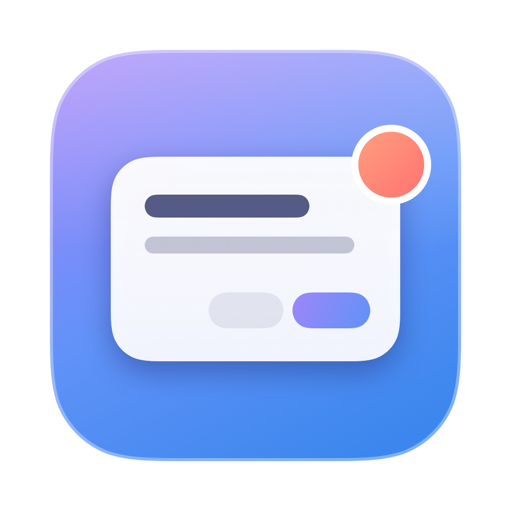

# nocnoc



A macOS menu-bar app that lets coding agents (Claude Code and Codex) reach
you when you're **not** looking at VS Code or the terminal. When an agent
needs a permission, has a question, or finishes, you get a notification or a
small floating panel. Your answer goes straight back to the waiting agent, so
it can carry on without you switching windows.

## What it does

| The agent… | You get… | You can… |
|---|---|---|
| wants permission to run a tool | a glass card (top right) with the full command and a sound | **Allow**, **Deny**, or hand it back to VS Code |
| asks a multiple-choice question (Claude's AskUserQuestion) | a glass card with the options | pick options, type your own answer, **Send** |
| calls `ask_user` mid-task (MCP tool, any agent) | the same question card | answer, or let it time out |
| finished, or needs your attention | a macOS notification | click it to jump to that project in VS Code |

Prompts only ever come through the app's own cards, never as macOS
notifications, so nothing competes with the card or covers it. The menu-bar
icon opens a glass popover with an **Away** switch, anything waiting for
you (Allow/Deny right there), and recent activity. While Away is off,
permission prompts stay in VS Code as usual and nocnoc keeps out of the way.

**Quiet while you're in VS Code** (on by default; it's in the gear menu).
While VS Code, a VS Code fork or a terminal is the app in front, prompt cards
wait out of sight, along with "finished" and "needs you" notifications.
You're looking at the agent's own prompt, so a card on top would only get in
the way. Switch to another app while a prompt is still open and its card
appears. `ask_user` questions always show, because only the card can answer
them.

You can answer wherever is closer. The agent shows its own prompt at the
same time, and the first answer wins. When you answer in VS Code, nocnoc
notices and clears its card and any "needs you" notification.

Cards are frosted glass that blurs whatever is behind them. On question
cards, **1–9** pick an option and **⏎** sends. **Esc** hands any card back to
VS Code. Drag a card to move it.

## How it works

```
 agent ──hook / MCP──▶ nocnoc-hook.sh or nocnoc-mcp ──unix socket──▶ nocnoc.app ──▶ you
   ▲                                                                     │
   └──────────── your answer (the hook's stdout / the tool result) ◀────┘
```

- **Hooks.** Claude Code and Codex run a shell command at certain moments,
  such as a `PermissionRequest`, and wait for it to finish. nocnoc's hook
  forwards the event to the app over a local unix socket. For permission
  prompts it waits there until you answer. Your answer comes back as the
  hook's output, in exactly the format the agent expects.
- **MCP.** `nocnoc-mcp` is a small stdio MCP server with one tool,
  `ask_user`. Agents can call it whenever they decide they need your input.
- **The socket.** It's a file only your user can open (`0600`), and it is
  never on the network.

### Safety rules

- **Anything that fails means "no decision", never "allow".** That covers the
  app not running, a timeout (~5 min), Away being off, or the agent
  cancelling. In each case the agent falls back to its normal prompt.
- **Allow is only offered for what you can read in full.** Cards show the
  whole command (scrolling if it's long). If it was too long even to keep
  (over 4,000 characters), there's no Allow and you answer in VS Code.
- **Allow always takes a deliberate click.** Cards never grab keyboard focus
  when they appear, so typing in your editor can't answer them, and Allow
  has no keyboard shortcut.
- **Closing a card hands the prompt back** to the editor. It never answers on
  your behalf.

## Install

Requires macOS 14+ and Xcode (Swift 6).

```sh
swift test             # 58 tests, including real socket round-trips
scripts/install.sh     # build -> ~/Applications/nocnoc.app, (re)start it
```

On first launch, allow notifications. The installed copy also turns on
**Open at login**, which you can toggle in the menu. Re-run
`scripts/install.sh` after every change.

Everything the agents run lives inside the installed app, so the repo can
move without breaking them:

| | Path |
|---|---|
| hook script | `~/Applications/nocnoc.app/Contents/Resources/nocnoc-hook.sh` |
| MCP server | `~/Applications/nocnoc.app/Contents/MacOS/nocnoc-mcp` |

In the snippets below, replace `~` with your full home path.

### Claude Code

Add to `~/.claude/settings.json` (all projects) or
`<repo>/.claude/settings.local.json` (one project):

```json
{
  "hooks": {
    "PermissionRequest": [{ "matcher": "*", "hooks": [{ "type": "command", "command": "~/Applications/nocnoc.app/Contents/Resources/nocnoc-hook.sh claude 300", "timeout": 320 }] }],
    "Notification":      [{ "matcher": "*", "hooks": [{ "type": "command", "command": "~/Applications/nocnoc.app/Contents/Resources/nocnoc-hook.sh claude", "timeout": 10 }] }],
    "Stop":              [{ "hooks": [{ "type": "command", "command": "~/Applications/nocnoc.app/Contents/Resources/nocnoc-hook.sh claude", "timeout": 10 }] }],
    "PostToolUse":        [{ "matcher": "*", "hooks": [{ "type": "command", "command": "~/Applications/nocnoc.app/Contents/Resources/nocnoc-hook.sh claude", "timeout": 5 }] }],
    "PostToolUseFailure": [{ "matcher": "*", "hooks": [{ "type": "command", "command": "~/Applications/nocnoc.app/Contents/Resources/nocnoc-hook.sh claude", "timeout": 5 }] }],
    "PermissionDenied":   [{ "matcher": "*", "hooks": [{ "type": "command", "command": "~/Applications/nocnoc.app/Contents/Resources/nocnoc-hook.sh claude", "timeout": 5 }] }],
    "UserPromptSubmit":   [{ "hooks": [{ "type": "command", "command": "~/Applications/nocnoc.app/Contents/Resources/nocnoc-hook.sh claude", "timeout": 5 }] }]
  }
}
```

The last four are "the session moved on" signals. When you answer a prompt in
VS Code instead of nocnoc, they let nocnoc clear that session's "needs you"
notification. `PostToolUse` runs on every tool call, which costs one short
local `curl`.

```sh
claude mcp add --transport stdio --scope user nocnoc -- ~/Applications/nocnoc.app/Contents/MacOS/nocnoc-mcp
```

The order of timeouts matters. `300` is how long nocnoc may hold a
permission prompt. The agent's `timeout` (`320`) must be larger, so nocnoc
always gives up first and the agent falls back cleanly.

### Codex

`~/.codex/hooks.json`:

```json
{
  "hooks": {
    "PermissionRequest": [{ "hooks": [{ "type": "command", "command": "~/Applications/nocnoc.app/Contents/Resources/nocnoc-hook.sh codex 300", "timeout": 320 }] }],
    "Stop":              [{ "hooks": [{ "type": "command", "command": "~/Applications/nocnoc.app/Contents/Resources/nocnoc-hook.sh codex", "timeout": 10 }] }]
  }
}
```

```sh
codex mcp add nocnoc -- ~/Applications/nocnoc.app/Contents/MacOS/nocnoc-mcp
```

Then, in `~/.codex/config.toml` under `[mcp_servers.nocnoc]`, add
`tool_timeout_sec = 3700` so Codex waits as long as your answer may take.

Codex skips new or changed hooks until you trust them, under **Settings →
Hooks** (or `/hooks` in the CLI). There's deliberately no `matcher`: Codex
reads matchers as regexes, and leaving it out matches everything. Codex has
no "needs you" event.

## Troubleshooting

- **Logs:** `~/Library/Logs/nocnoc.log` (rotated at 1 MB).
- **Is it up?**
  `curl --unix-socket ~/Library/Application\ Support/nocnoc/nocnoc.sock http://nocnoc/v1/health`
- **Is the agent sending what we think?** Turn on **Record raw payloads** in
  the menu. Every hook body is then saved to
  `~/Library/Logs/nocnoc-payloads.log`. Turn it off afterwards: it contains
  your commands.

## Known gaps

- **Codex permission prompts** follow Codex's documentation, but a real one
  hasn't been captured yet. Codex hooks are verified live via `Stop`, and
  `ask_user` is verified from Codex.
- **Codex hooks inside the VS Code extension:** not documented whether they
  run there.
- **Rebuild and reinstall to update.** There's no auto-update; run
  `scripts/install.sh`.

## Layout

| Path | What |
|---|---|
| `Sources/NocnocCore/` | socket server and client, HTTP parser, hook payload → event, router, held requests, MCP server logic |
| `Sources/nocnoc/` | the menu-bar app: state, notifications, menu, question panel |
| `Sources/nocnoc-mcp/` | the stdio MCP server executable |
| `hooks/nocnoc-hook.sh` | what agents run; forwards the event to the app with `curl` |
| `scripts/` | `build-app.sh` (bundle + sign), `install.sh`, `make-icon.swift` (renders the app icon) |
| `Tests/NocnocCoreTests/` | unit tests and real socket round-trips |
| `.claude/hooks/spy.sh` | the Phase 0 recorder used to capture real hook payloads |
